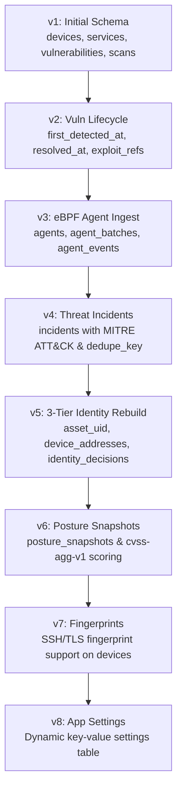

# Database Architecture & Schema

Cerberus uses an embedded **SQLite** database configured for high-concurrency read operations and atomic transaction safety.

---

## Storage Engine Configuration

In `internal/storage/storage.go`, the database connection pool is configured with optimal embedded settings:

- **Write-Ahead Logging (`PRAGMA journal_mode = WAL`):** Enables simultaneous readers while background scan workers commit new device and vulnerability records.
- **Foreign Key Enforcement (`PRAGMA foreign_keys = ON`):** Enforces relational integrity across cascaded deletes (e.g., removing a device automatically deletes all associated services, vulnerabilities, and timeline snapshots).
- **Busy Timeout (`PRAGMA busy_timeout = 5000`):** Prevents database lock errors under bursty agent ingest batches.

---

## Schema Evolution (Migrations 1 to 8)

Cerberus enforces a strict versioned migration system managed by `internal/storage/migrations.go`. The database version is tracked using SQLite's internal `PRAGMA user_version`.



---

## Detailed Table Reference

### Core Inventory Tables

#### `devices`
The primary asset catalog. Stores identity metadata, random MAC flags, and calculated risk scores.

```sql
CREATE TABLE devices (
    id INTEGER PRIMARY KEY AUTOINCREMENT,
    current_ip TEXT NOT NULL,
    mac TEXT,
    hostname TEXT,
    vendor TEXT,
    status TEXT NOT NULL DEFAULT 'up',
    first_seen DATETIME NOT NULL,
    last_seen DATETIME NOT NULL,
    asset_uid TEXT NOT NULL UNIQUE,       -- Persistent UUID
    mac_is_random INTEGER NOT NULL DEFAULT 0,
    port_profile_hash TEXT,
    managed INTEGER NOT NULL DEFAULT 0,
    identity_confidence REAL NOT NULL DEFAULT 1.0,
    label TEXT,
    criticality TEXT NOT NULL DEFAULT 'normal',
    notes TEXT,
    fingerprints TEXT NOT NULL DEFAULT ''
);
```

#### `device_addresses`
Maintains the complete historical record of IP address leases attached to each device. Allows Cerberus to identify when a host moves to a new IP or rotates between Wi-Fi subnets.

```sql
CREATE TABLE device_addresses (
    id INTEGER PRIMARY KEY AUTOINCREMENT,
    device_id INTEGER NOT NULL REFERENCES devices(id) ON DELETE CASCADE,
    ip TEXT NOT NULL,
    mac TEXT,
    first_seen DATETIME NOT NULL,
    last_seen DATETIME NOT NULL,
    closed INTEGER NOT NULL DEFAULT 0
);
```

#### `services` & `vulnerabilities`
Stores open port profiles and detected CVEs. Re-scans mark resolved vulnerabilities as `status = 'resolved'` with a `resolved_at` timestamp rather than simply dropping the row, preserving audit trails.

---

### Ingest & Threat Tables

#### `agents` & `agent_events`
Ingests batches from the eBPF kernel agent. Batches are deduplicated using `(agent_id, boot_id, seq)` to handle machine reboots cleanly.

#### `incidents`
Records deterministic security detections. Uses `dedupe_key` to merge repeating alerts over a 5-minute sliding window into a single hit counter (`hit_count`).

```sql
CREATE TABLE incidents (
    id INTEGER PRIMARY KEY AUTOINCREMENT,
    device_id INTEGER REFERENCES devices(id) ON DELETE CASCADE,
    agent_id TEXT NOT NULL REFERENCES agents(agent_id) ON DELETE CASCADE,
    rule_id TEXT NOT NULL,
    ruleset_version TEXT NOT NULL,
    title TEXT NOT NULL,
    severity TEXT NOT NULL,
    score REAL NOT NULL,
    mitre_tactic TEXT,
    mitre_technique TEXT,
    pid_root INTEGER,
    dedupe_key TEXT NOT NULL,
    first_seen_at DATETIME NOT NULL,
    last_seen_at DATETIME NOT NULL,
    hit_count INTEGER NOT NULL DEFAULT 1,
    evidence_event_ids TEXT NOT NULL,
    status TEXT NOT NULL DEFAULT 'open'
);
```
