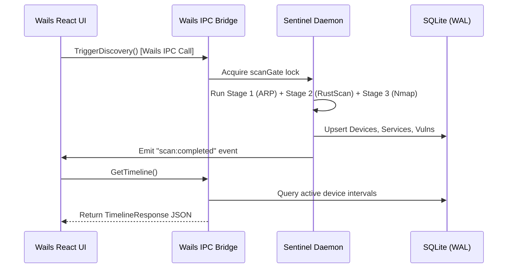

# System Global Architecture

Cerberus is organized into three distinct tiers that run cooperatively to provide end-to-end security observability:

1. **Cerberus Desktop:** A native desktop application built with **Wails v2**, embedding the Go Sentinel daemon directly in-process.
2. **Cerberus Sentinel:** The central Go daemon containing the scheduling engine, hybrid scanner, identity resolver, posture calculator, and SQLite storage.
3. **Cerberus Agent:** A lightweight eBPF probe running in Linux kernel space, streaming process and network activity into Sentinel.

<ArchitectureFlow />

---

## Architectural Principles

### 1. Zero Cloud Dependency (Local-First)
All telemetry, device histories, scan results, and vulnerability CVE records are stored exclusively in an embedded SQLite database on your local machine (`cerberus.db`). No telemetry or private IP addresses leave your network.

### 2. IPC Over HTTP for Desktop UI
Unlike many modern web-based administrative consoles that expose a local web server (which can be vulnerable to Cross-Site Scripting or unauthorized LAN access), the Cerberus Desktop UI **never uses HTTP**.

Instead, the React frontend communicates with the Go backend through **Wails v2 Inter-Process Communication (IPC)** using native runtime bindings (`window.go.main.Bridge`).



### 3. Loopback-Only Ingest Endpoint
The only HTTP listener started by the daemon is the agent telemetry ingest server. By default, it binds strictly to `127.0.0.1:8080`. Any attempt to bind to external or non-loopback addresses is refused by `internal/ingest/server.go` to prevent unauthorized network injections.

---

## Component Layout

The repository is modularized into clean Go packages under `internal/`:

```text
├── cmd/
│   ├── sentinel/          # Headless CLI entrypoint (systemd / Docker)
│   └── helper/            # Privileged macOS helper (SMJobBless)
├── desktop/               # Wails v2 application shell & IPC bridge
├── front/                 # React UI frontend (submodule)
└── internal/
    ├── app/               # Daemon lifecycle & IPC business logic
    ├── scanner/           # Tri-Stage HybridEngine, Nmap & RustScan runners
    ├── scheduler/         # Periodic scan scheduling & serialized scanGate
    ├── identity/          # 3-Tier identity matcher & multi-channel resolver
    ├── detect/            # Deterministic MITRE ATT&CK threat engine
    ├── posture/           # Deterministic cvss-agg-v1 scoring
    ├── ingest/            # Loopback eBPF agent ingest server
    └── storage/           # SQLite migrations (1–8), queries, and transactions
```
