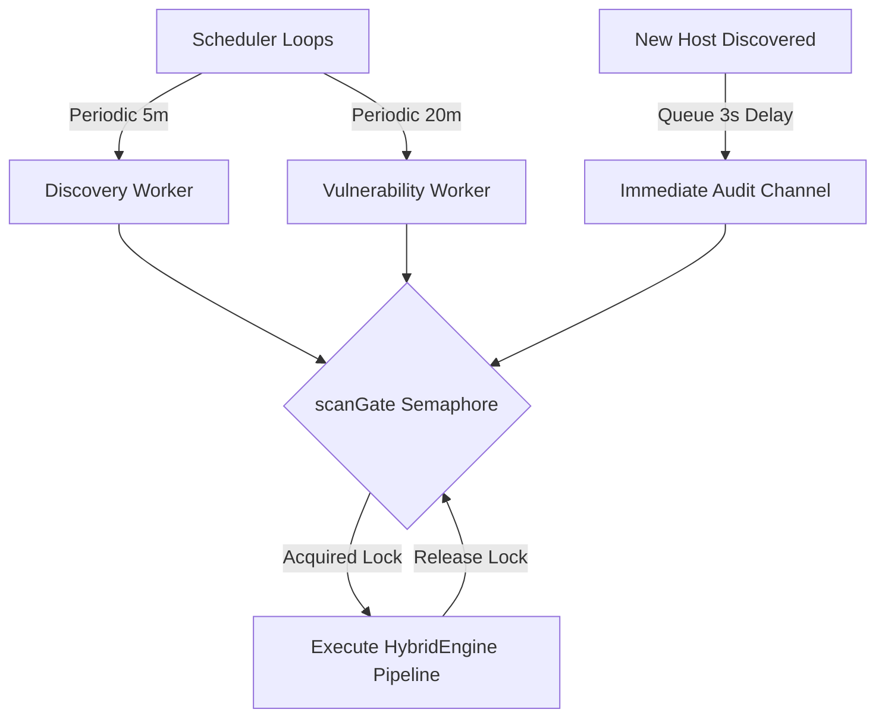

# Subsystems & Components

Cerberus is built from modular, decoupled subsystems within the `internal/` directory. Each subsystem performs a focused responsibility and communicates through typed Go interfaces.

---

## 1. Scanner Subsystem (`internal/scanner`)

The Scanner subsystem coordinates low-level link-layer operations and socket sweeping:

- **`HybridEngine`:** The master controller. Executes the tri-stage pipeline (`Discover` for subnet sweeps, `Audit` for in-depth host vulnerability inspection).
- **`Stage1ARPSweep`:** Generates burst UDP probes across the subnet to populate link-layer tables and queries native OS neighbor caches.
- **`Stage2RustScan`:** Executes async socket tests against the full port range (1–65535) with configurable batching.
- **`Stage3NmapAudit`:** Invokes Nmap with service identification (`-sV`) and NSE vulnerability scripts against only confirmed open ports.
- **`Privilege & Preflight`:** Verifies raw socket access before initiating scans (`cap_net_raw` on Linux, `SMJobBless` helper on macOS, `Npcap` on Windows). Never degrades to unprivileged TCP connect mode.

---

## 2. Scheduler Subsystem (`internal/scheduler`)

The Scheduler manages autonomous background workers and enforces strict scan isolation:

- **`scanGate` (Serialized Semaphore):** A single-slot buffered channel (`chan struct{}`) that acts as a mutual exclusion lock. Prevents discovery sweeps, vulnerability audits, and manual scans from overlapping or exhausting network bandwidth.
- **`Discovery Worker`:** Executes the startup sweep and periodic 5-minute lightweight checks.
- **`Vulnerability Worker`:** Runs 20-minute cyclical vulnerability audits across known active hosts.
- **`Immediate Audit Queue`:** A dedicated buffered channel (`immediateVulnCh`) that receives newly discovered hosts and initiates targeted audits after a 3-second grace period.

---

## 3. Identity Subsystem (`internal/identity`)

Reconciles changing IP addresses and randomized MAC addresses to maintain stable device records over time:

- **`MultiChannelResolver`:** Queries Bonjour/mDNS, NetBIOS (UDP 137), UPnP endpoints, and router gateway reverse DNS (PTR) in parallel to extract friendly hostnames and OS details.
- **`3-Tier Matcher`:** Evaluates incoming observations against candidate devices using a weighted deterministic scoring matrix:
  - *Tier 1:* Cryptographic digital signatures & cooperative agent interfaces.
  - *Tier 2:* Hardware Universal MAC (UAA) and persistent randomized Local MAC (LAA).
  - *Tier 3:* Hostname and open port fingerprint synergy.

---

## 4. Threat Detection Engine (`internal/detect`)

Processes streaming eBPF events from Linux hosts in real time:

- **`Engine`:** Dispatches event batches across worker shards (`shardQueueDepth = 64`) to prevent lock contention.
- **`Deterministic Ruleset`:** Evaluates process lifecycle events against MITRE ATT&CK patterns without reliance on external cloud rule lookups.
- **`Incident Deduplication`:** Deduplicates repeating alerts over a 5-minute sliding window using cryptographic keys (`dedupe_key`).
- **`EngineMetrics`:** Tracks detection latency using Algorithm R reservoir sampling (`reservoirSize = 2048`) to compute accurate 95th-percentile (P95) latency statistics.

---

## 5. Agent Ingest Subsystem (`internal/ingest`)

Receives authenticated telemetry from the Linux eBPF probe:

- **Loopback Enforcement:** Binds strictly to `127.0.0.1:8080`.
- **Enrollment Flow (`POST /api/v1/agent/enroll`):** Exchanges an enrollment secret (`CERBERUS_ENROLL_TOKEN`) for an agent bearer token stored as a SHA-256 hash.
- **Batch Processing (`POST /api/v1/agent/telemetry`):** Parses compressed event batches, checks boot IDs for agent restarts, and drops duplicate sequence numbers.

---

## 6. Posture Subsystem (`internal/posture`)

Calculates standardized fleet risk using the `cvss-agg-v1` policy:

- Evaluates maximum effective CVSS scores per host.
- Applies a **1.2x multiplier** for vulnerabilities with public exploit code.
- Computes aggregate fleet security scores on a 0.0 to 100.0 scale and stores periodic posture snapshots.
