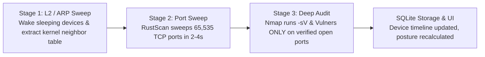

# Overview & Key Capabilities

Cerberus provides complete situational awareness of your local network environment. It tracks which devices exist, what software services they run, which security flaws are exposed, and what actions are taking place at the Linux kernel level.

---

## 1. Tri-Stage Hybrid Scanning Engine

Rather than relying on a single scanning binary, Cerberus chains three specialized tools into an optimized pipeline (`internal/scanner.HybridEngine`):

1. **Stage 1 — L2 & ARP Mapping:** Sends lightweight UDP datagrams to wake sleeping mobile devices and immediately extracts link-layer MAC addresses directly from OS kernel tables (`netlink` on Linux, `sysctl` on macOS, `GetIpNetTable2` on Windows).
2. **Stage 2 — Port Sweep:** Uses RustScan's asynchronous socket engine to probe all 65,535 TCP ports. If RustScan is unavailable, it automatically falls back to Nmap.
3. **Stage 3 — Targeted Deep Audit:** Runs Nmap service version detection (`-sV`) and vulnerability auditing scripts (such as `vulners`) **only against verified open ports**. Probing closed ports is completely eliminated.

<PipelineVisualizer />

---

## 2. Scheduled & Reactive Scanning

Scanning is governed by a serialized scheduler (`internal/scheduler.Scheduler`) with a dedicated concurrency gate (`scanGate`). Scans never collide or saturate the network:

- **Startup Sweep:** Performs an immediate, full-scope sweep of the subnet when Cerberus launches.
- **5-Minute Known-Device Check:** Sends a single UDP probe per known address to keep the kernel neighbor cache fresh with zero noticeable network traffic.
- **20-Minute Vulnerability Audit:** Re-checks active devices to ensure no new vulnerable ports have opened.
- **Immediate Host Audit:** When a new device appears (detected passively via mDNS/SSDP announcements or kernel ARP updates), Cerberus automatically triggers an immediate targeted audit after a brief 3-second settling grace period.

---

## 3. Real-Time Endpoint Threat Detection

For Linux servers and workstations running the lightweight `cerberus-agent`, eBPF kernel hooks stream high-fidelity event batches into the Sentinel daemon:

<MetricBar
  label="eBPF Event Ingest to Detection Lag (P95)"
  value="4.2ms"
  percentage={96}
  benchmark="Target: < 50ms"
  color="purple"
  subtext="Sharded dispatcher runs deterministic MITRE ATT&CK rules concurrently in Go."
/>

### Supported Detection Rules
- **Reverse Shells:** Detects non-interactive shells spawned with network sockets attached (e.g. `bash -i >& /dev/tcp/...`).
- **Webshell Activity:** Catches child process execution spawned by web server daemons (`nginx`, `apache2`, `caddy`).
- **Process Memory Injection:** Monitors `ptrace`, `process_vm_writev`, and suspicious cross-process memory manipulation.
- **Sensitive File Tampering:** Tracks unauthorized writes to `/etc/shadow`, `/etc/sudoers`, or authorized SSH keys.

---

## 4. Deterministic Fleet Posture (`cvss-agg-v1`)

Rather than guessing risk, Cerberus calculates a reproducible security posture score ranging from **0.0 (catastrophic)** to **100.0 (flawless)**:

$$\text{Risk}_h = s_1 + (10 - s_1) \cdot \gamma \cdot \left[ 1 - \prod_{i \ge 2} \left( 1 - \left(\frac{s_i}{10}\right)^2 \right) \right]$$

- **Exploit Multiplier:** CVEs with known public exploit scripts carry a 1.2x penalty multiplier.
- **Incident Penalties:** Active endpoint security incidents deduct directly from the host score.
- **Aggregated Fleet Health:** Mean risk and peak vulnerability exposure are summarized in a single posture dashboard.

---

## 5. Deployment Modes

Cerberus is designed to run in multiple operating modes depending on your infrastructure:

| Mode | Entry Point | Description |
|---|---|---|
| **Desktop App (Recommended)** | `desktop/` | Wails v2 native application. Embeds the Go daemon in-process and communicates via IPC. Available for macOS, Windows, and Linux. |
| **Headless Daemon** | `cmd/sentinel` | Lightweight CLI service. Runs autonomously on Linux servers, NAS appliances, or edge gateways. Stores state in SQLite. |
| **eBPF Probe** | `cerberus-agent` | Low-profile Linux C/eBPF daemon streaming kernel events to `127.0.0.1:8080`. |
