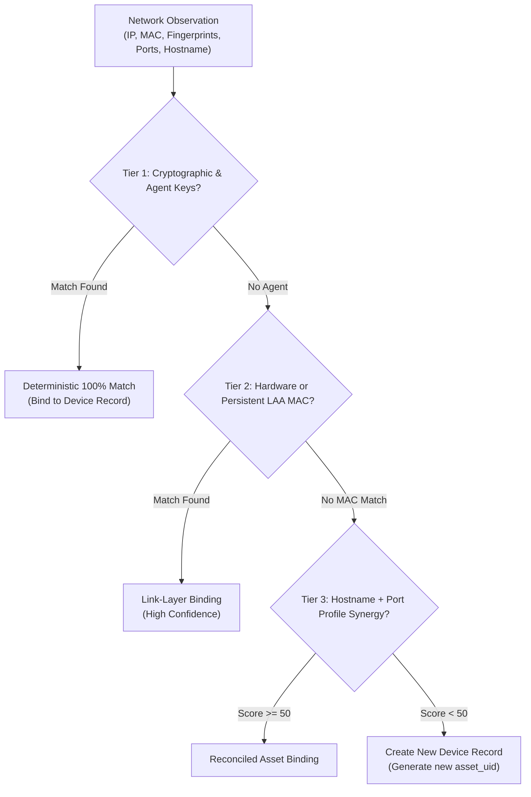

# Identification of Each Device Type

Modern local networks are filled with smartphones, laptops, smart TVs, and IoT appliances that actively hide their true identity or rotate their addresses. Cerberus solves this challenge using a deterministic **3-Tier Identification Hierarchy** coupled with a **Multi-Channel Resolver**.

---

## The 3-Tier Identity Hierarchy

When Cerberus observes an endpoint on the network, it runs the deterministic matcher (`internal/identity/matcher.go`) through three tiers of evidence:

---

### Tier 1: Cryptographic & Cooperative Identity (Confidence: 100%)
- **How It Works:** If a device runs the `cerberus-agent`, its cryptographic Agent ID and hardware interface list are checked first. Even if the device changes both its IP and MAC address across subnets, Cerberus recognizes it instantly.
- **Digital Fingerprints:** For servers without an agent, Cerberus extracts persistent cryptographic fingerprints:
  - **SSH Host Key Fingerprints:** SHA-256 hashes of the public host key (e.g., `ssh-ed25519`).
  - **TLS Certificate Hashes:** Unique SHA-256 hashes from HTTPS/TLS certificates.
  - **UPnP / SMB UUIDs:** Universally unique hardware identifiers broadcast by printers and NAS servers.

---

### Tier 2: Link-Layer MAC Identity
- **Universal Hardware MAC (UAA):** For standard devices with burned-in factory MAC addresses, Cerberus matches the IEEE Organizationally Unique Identifier (OUI) to identify the vendor (e.g., Apple, Dell, Sony, Espressif).
- **Per-Network Randomized MAC (LAA):** Modern iOS, Android, and Windows devices randomize their MAC addresses to protect user privacy. Cerberus inspects the Locally Administered Address (LAA) bit:
  $$\text{Byte 0, Bit 1} = 1 \implies \text{Randomized MAC}$$
  Because iOS and Android persist the same randomized MAC for a specific saved Wi-Fi network, Cerberus tracks these devices reliably over time.

---

### Tier 3: Deferred Hostname & Port Fingerprinting
If a device has neither an agent nor a stable MAC address (e.g., aggressive private MAC rotation), Cerberus reconciles identity using behavioral synergy:
- **Hostname Normalization:** Matches normalized NetBIOS computer names and mDNS local hostnames.
- **Port Profile Hash:** Hashes the set of open ports and services (e.g., a device exposing ports `80`, `554`, `8000` matches an RTSP IP camera profile).
- **Deterministic Score:** If the combined match score exceeds the threshold ($\text{Score} \ge 50.0$) and beats any runner-up by a safety margin ($\text{Margin} \ge 15.0$), Cerberus binds the sighting to the existing device.

---

## The Sleeping Mobile Classifier

One of the most difficult challenges in modern network auditing is identifying mobile smartphones in sleep mode. 

When an iPhone or Android phone sits with its screen locked, the main CPU powers down into deep sleep. The low-power Wi-Fi chip stays awake to respond to link-layer ARP queries, but **drops or closes all incoming TCP port connections**:

<IssueCard
  title="Sleeping Mobile Heuristic Classifier"
  problem="Smartphones appear as anonymous ghost IPs with 0 open ports, confusing scanners into reporting them as dead or unknown hosts."
  cause="Mobile operating systems close all listening ports during sleep to preserve battery life, while the Wi-Fi SoC handles ARP offload."
  solution="Cerberus checks: 1) LAA bit == 1 (Randomized MAC), 2) Responded to Stage 1 ARP sweep, 3) Exactly 0 open TCP ports or all ports tcpwrapped."
  impact="Accurately identifies device as 'Mobile Smartphone (Sleeping / Power-Saving)' with 85% confidence."
/>

---

## Parallel Identity Channels

During discovery, `MultiChannelResolver` executes four enrichment channels in parallel:

| Channel | Target Devices | Data Extracted |
|---|---|---|
| **Bonjour / mDNS** | Apple Macs, iPhones, Apple TVs, Google Cast | Friendly names (e.g. `Living-Room-Apple-TV.local`) |
| **NetBIOS (UDP 137)** | Windows PCs, Samba file servers, NAS drives | Windows Workgroup and NetBIOS Computer Name |
| **Router Gateway PTR** | Any device receiving an address via DHCP | Hostname registered with the router DNS server |
| **UPnP Discovery** | Smart TVs, Media Servers, IoT Hubs, IP Cameras | Manufacturer name, model number, device description XML |
