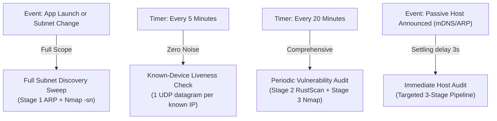

# Scan Types & Scanning Lifecycle

In most network environments, running aggressive full-port sweeps continuously is intrusive and degrades Wi-Fi quality. Cerberus employs an intelligent **tiered cadence** that balances continuous real-time awareness with zero network noise.

---

## The Four Scan Types

---

### 1. Full Subnet Discovery Sweep
- **When It Runs:** Automatically on application startup, when switching Wi-Fi networks/interfaces, or on manual user trigger.
- **What It Does:** Executes Stage 1 broadcast UDP prods across the entire subnet (e.g., `192.168.1.0/24`), extracts neighbor tables, and runs Nmap host discovery (`-sn -T4`).
- **Goal:** Establishes the baseline inventory of active hosts, hardware MAC addresses, and vendor identities.

---

### 2. 5-Minute Known-Device Liveness Check
- **When It Runs:** Every 5 minutes (`CERBERUS_DISCOVERY_INTERVAL = 5m`).
- **What It Does:** Rather than sweeping the entire subnet again, it sends a single lightweight UDP datagram to each known address. This prods the router and host to refresh their entry in the operating system's kernel ARP cache.
- **Why It Matters:** Generates virtually **zero measurable network traffic** (less than 1 KB total), ensuring laptops and phones stay active on the dashboard without draining their batteries.

---

### 3. 20-Minute Vulnerability Audit
- **When It Runs:** Every 20 minutes (`CERBERUS_VULN_INTERVAL = 20m`).
- **What It Does:** Executes the full Stage 2 port sweep (RustScan) and Stage 3 vulnerability audit (Nmap + `vulners`) against all online hosts.
- **Goal:** Confirms whether previously opened ports have closed, detects newly started services, and recalculates the fleet posture score.

---

### 4. Immediate Reactive Host Audit
- **When It Runs:** The moment an unknown IP address or new MAC address is observed between scheduled cycles.
- **Grace Period (3s):** Waits 3 seconds (`CERBERUS_IMMEDIATE_DELAY`) to allow newly connected phones or laptops to finish DHCP handshake negotiation.
- **Goal:** Audits the new device immediately without waiting 20 minutes for the next cycle.

---

## Passive Discovery Channels

Between active scan runs, Cerberus listens passively for device announcements using background listeners (`internal/identity/channel_multicast.go`):

- **mDNS / Bonjour (UDP 5353):** Catches Apple AirPlay, Chromecast, and smart home devices as soon as they join the Wi-Fi.
- **SSDP / UPnP (UDP 1900):** Captures routers, smart TVs, and media servers announcing their presence.
- **Kernel Neighbor Table Polling:** Detects when the operating system kernel communicates with a new neighbor.

---

## Why Privileged Execution Is Mandatory

Cerberus strictly enforces **privileged execution** (Administrator on Windows, root or capabilities on Linux, root helper on macOS).

> [!CAUTION]
> **No TCP Connect Fallback (`-sT`):** Many consumer scanning tools fall back to unprivileged TCP Connect scans if permissions are missing. Cerberus deliberately refuses to do this. An unprivileged scan cannot inspect the link layer, cannot read MAC addresses, cannot detect filtered firewall states, and causes deceptive security ratings. If privileges are refused, Cerberus stays idle and reports the capability warning in the UI.
